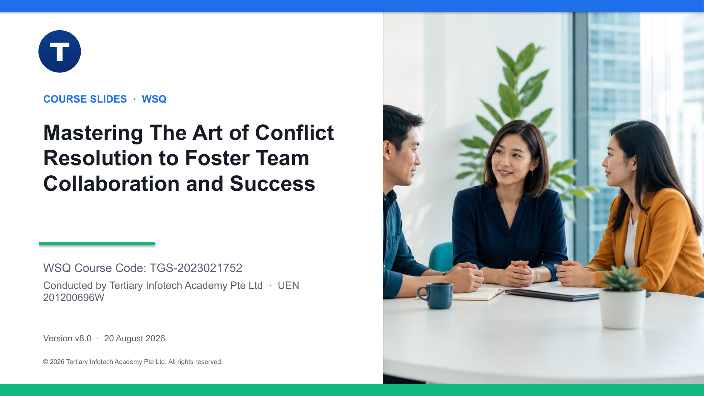

# Mastering The Art of Conflict Resolution to Foster Team Collaboration and Success

WSQ courseware for **TGS-2023021752**, aligned to the Conflict Management Technical Skill and Competency (RET-PMD-4001-1.1).

## Courseware

- Visual trainer slide deck: [PowerPoint](courseware/Mastering%20The%20Art%20of%20Conflict%20Resolution%20to%20Foster%20Team%20Collaboration%20and%20Success-v8.0.pptx) · [PDF](courseware/Mastering%20The%20Art%20of%20Conflict%20Resolution%20to%20Foster%20Team%20Collaboration%20and%20Success-v8.0.pdf)
- Detailed Learner Guide: [Word](courseware/LG-Mastering%20The%20Art%20of%20Conflict%20Resolution%20to%20Foster%20Team%20Collaboration%20and%20Success.docx) · [PDF](courseware/LG-Mastering%20The%20Art%20of%20Conflict%20Resolution%20to%20Foster%20Team%20Collaboration%20and%20Success.pdf)
- Two-day Lesson Plan: [Word](courseware/LP-Mastering%20The%20Art%20of%20Conflict%20Resolution%20to%20Foster%20Team%20Collaboration%20and%20Success.docx) · [PDF](courseware/LP-Mastering%20The%20Art%20of%20Conflict%20Resolution%20to%20Foster%20Team%20Collaboration%20and%20Success.pdf)
- Eight self-contained workplace activities in [`activities/`](activities/)

The slide deck is concept-led and facilitative. Detailed procedures, scenarios, role cards, questions, worksheets, evidence requirements and checklists are kept in the Learner Guide and individual activity folders.

## Learning outcomes

Learners will be able to:

1. Identify early indicators of workplace conflicts and minimise their impact.
2. Decide and apply suitable conflict resolution strategies while dealing with conflict sensitively.
3. Analyse team conflict and coach team members to resolve disagreements constructively.
4. Review resolution effectiveness and take action to prevent conflict recurrence.

## Activity sequence

1. Conflict Signal Triage at LionCity Retail
2. Evidence Interview and Root-Cause Map at HarborLink Logistics
3. Conflict Style Choice Clinic at BrightWorks Digital
4. Mediated Conversation at Mosaic Creative
5. Interest-Based Negotiation at CarePoint Clinics
6. Leader Coaching Huddle at NovaTech Services
7. Policy, Ethics and Escalation at Meridian Hospitality
8. 30-Day Resolution Review at GreenGrid Engineering

The cases are fictional workplace simulations. They are designed for learning and do not replace organisational policy, HR advice or legal advice.

Course information: [Tertiary Courses](https://www.tertiarycourses.com.sg/wsq-mastering-the-art-of-conflict-resolution-to-foster-team-collaboration-and-success.html)
